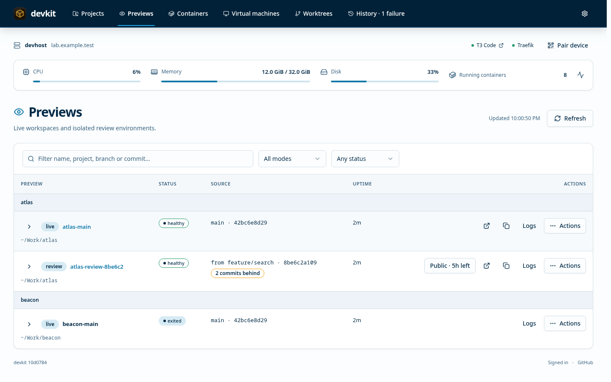
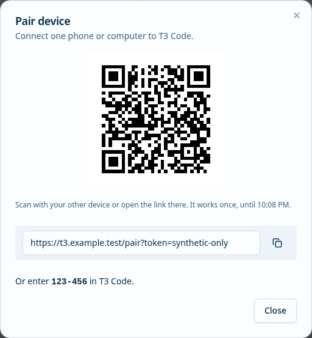
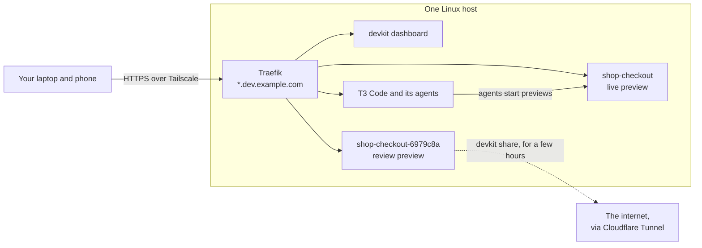

# devkit

Private HTTPS previews for every Git worktree, and a home for your coding agents, on your own
Linux box.

<picture>
  <source media="(prefers-color-scheme: dark)" srcset="docs/images/dashboard-dark.png">
  
</picture>

Coding agents work best side by side, each in its own Git worktree. devkit gives every worktree
its own running copy of your app (its containers, database and data) at a private HTTPS address
such as `https://shop-checkout.dev.example.com`, reachable only from your devices on your
[Tailscale](https://tailscale.com) network. A dashboard shows every preview and worktree, and the
agents ([T3 Code](https://t3.codes) by default) run on the same host, so they keep working when you
close your laptop.

> [!NOTE]
> devkit is a personal tool: I built it for my own development boxes and share it as it is. Feel
> free to use it, fork it or take ideas from it. Issues and [pull requests](CONTRIBUTING.md) are welcome, though
> it's a side project, so replies may take a while. There is no roadmap and no promise that the
> next version stays compatible.

## What it's for

- **Agents in parallel.** Three agents on three branches each get an app and a database of their
  own to run and test against: no port clashes, no shared data. `devkit live` in a worktree starts
  one, and an agent can run it itself.
- **Reviewing what an agent built.** `devkit review HEAD` builds the exact commit into an image and
  runs it apart from the live preview, so what you click through is what you would ship. Open it
  from your laptop or your phone.
- **Steering agents from anywhere.** T3 Code is served at `https://t3.<your domain>`. Connect a phone
  or another computer by scanning a QR code on the dashboard.
- **Showing someone outside.** `devkit share` makes a preview public through a Cloudflare Tunnel
  for a few hours, for a coworker or to test signing in with Google, and ends it by itself.
- **Keeping the box tidy.** The dashboard shows CPU, memory and disk, container logs and what
  happened when; `devkit gc` and `devkit prune` clear up after removed worktrees and old builds.

<picture>
  <source media="(prefers-color-scheme: dark)" srcset="docs/images/pair-dark.png">
  
</picture>

## How it works



Everything runs on one Linux host. Traefik listens only on the host's Tailscale address (unless
you [add others](docs/setup.md#beyond-the-tailnet), such as its LAN address) and holds a wildcard
certificate for `*.<your domain>`, obtained through your DNS provider's API, so no port is open to
the internet. Each preview is a Docker Compose project described by a small
`devkit.json` in your repository, and Traefik routes to it by its Docker labels. devkit itself is
one Go binary with the dashboard built in. It keeps no database: Git knows the worktrees and
Docker labels know the previews.

## What it isn't

- **One host, Linux only.** Bootstrap supports Ubuntu, Debian and Fedora (tested on Ubuntu 26.04
  and Fedora 44). Hosts don't know about each other.
- **Not for production or untrusted users.** Everyone on your tailnet can read the dashboard and reach
  the previews, and the host is assumed to be yours. Apps on it are not isolated from each other.
- **Not a CI or deployment system.** Deploying for team review goes through a `publish` hook you
  write (see [Publishing](docs/publishing.md)).
- **Explicit Git controls only.** Fetch origin, fast-forward a clean branch from its origin
  upstream, or push separately. New project creation makes its initial commit; devkit never
  commits changes in existing projects, creates/deletes worktrees, stashes, rebases or force-pushes.
  Resolve dirty or diverged branches with your own Git tools.

## Quick start

You need a Linux host with systemd (Ubuntu, Debian or Fedora for the bootstrap script; 2 GB of
memory or more), a Tailscale account, and a domain whose DNS has an API for the wildcard
certificate (Cloudflare gets the guided path). Signed in to the host as the user who will run
devkit, not root:

```sh
# arm64 hosts: devkit-linux-arm64.tar.gz
curl -fsSL https://github.com/steenfeldt/devkit/releases/latest/download/devkit-linux-amd64.tar.gz | tar -xz
cd devkit
./bootstrap.sh                      # Docker, Tailscale and lingering, with sudo; open the Tailscale link it prints
# log out and back in, so Docker works without sudo
install -D devkit ~/.local/bin/devkit
devkit setup                        # guided OpenBao initialization, credentials, certificate, dashboard and T3 Code
```

Then open `https://devkit.<your domain>` from a device on your tailnet, and set a dashboard
password with `devkit web password` to act from it. For a first project, configure
`projects_dir` and your global Git name/email, then run
`devkit project create my-app` (or use **Projects → Create Project**) and run `devkit live`
in the new folder; see
[Project recipe](docs/projects.md) for your own apps and [Host setup](docs/setup.md) for details.

To create a private GitHub repository with the project, first follow
[GitHub token setup](docs/secrets.md#github-token-for-project-creation): create a
fine-grained token for the intended owner with **All repositories** access,
**Repository creation: Read and write** (or **Administration: Read and write**) and
**Contents: Read and write**. Save it in **Secrets → Integrations** as service `github`,
key `token`. Then enable **Create GitHub repository**, enter the owner/repository name,
and select **Push initial commit**. Keep **Public repository** unchecked for a private repo.

```sh
devkit project create my-app --github-owner YOUR_USER_OR_ORG --github-repo my-app --github-push
```

Owner and push are chosen per project. Without `--github-push`, the initial commit stays
local. `devkit integrations github status --verify` checks credential acceptance; it does
not verify every creation/write grant or perform a test push.

For headless or graphical QEMU VMs, `./bootstrap.sh --qemu` adds the optional Fedora/Ubuntu prerequisites.
Set `"projects_dir": "~/Work"` in the [host config](docs/setup.md#host-config) to discover
project folders automatically. The dashboard's **Projects** tree groups main checkouts,
worktrees, container previews and VMs, with launch controls after sign-in.
The dashboard groups VMs by project using [VM mappings](docs/projects.md#virtual-machines),
with unmatched guests under Other VMs. Opt-in launcher/libvirt controls add start, stop and restart,
including stopped managed VMs. See [VM connections](docs/dashboard.md#virtual-machines).

## Commands

Worktree → agent work → commit → local review → explicit team deployment → merge.
Start a live preview whenever you want a longer back-and-forth session.

devkit does not create or delete worktrees. Your tools (T3 Code, Orca, or plain
`git worktree add`) own them; devkit only manages the environment (containers,
volumes, preview URL) of whichever worktree it runs in. Creating a worktree does
not start services. Only explicit project creation makes an initial commit. Git push is explicit: select
initial push during GitHub project creation, or run a separate push command afterward. The kit does not merge or install system software; `devkit setup`
configures the rest of the host from your answers.

External applications can use scoped, expiring Devkit API tokens to read or manage
project secrets with the same inheritance and cleanup as the CLI. Native OpenBao
API access is also available for app-owned storage over LAN/Tailscale HTTPS. See
[external secrets clients](docs/secrets-api.md) for authentication and examples.

| Command | Behavior |
|---|---|
| `devkit setup` | Configure this host step by step; safe to run again (see [Host setup](docs/setup.md)) |
| `devkit vault` | Manage OpenBao setup, manual unseal, encrypted backups and explicit updates |
| `devkit secrets` | Save/generate development passwords with scoped inheritance and configurable cleanup |
| `devkit secrets tokens` | Create/list/revoke scoped API tokens for external applications |
| `devkit integrations` | Store integration credentials and bind exact Git HTTPS remotes |
| `devkit agents skills` | Install/status/repair Codex and Claude Code secret guidance |
| `devkit doctor` | Check the host and say how to fix what is missing |
| `devkit docs list` / `devkit docs read PATH` | List and read Markdown under docs/, root README and agent guidance in the current registered checkout |
| `devkit docs save PATH --expected VERSION\|new --file FILE\|-` | Create or edit a document under docs/ with stale-edit protection; no commit |
| `devkit project create NAME [--remote URL] [--agents-file FILE\|-]` | Copy the built-in template into projects_dir, append agent instructions, initialize main and commit; optionally set origin or [create a GitHub repository](docs/projects.md#create-a-project) with `--github-owner OWNER --github-repo REPO [--github-public] [--github-push]` |
| `devkit version` | Show which devkit release or commit this is (the dashboard's footer shows it too) |
| `devkit proxy up` | Write Traefik's configuration from the host config and start or update it |
| `devkit up` | Alias for `devkit live` |
| `devkit up/start/stop/restart --vm TARGET` | Control a configured VM through its launcher or libvirt; retain disks |
| `devkit live` | Start/resume current workspace's live preview |
| `devkit review HEAD` | Clean checkout, checks, image build, isolated review runtime |
| `devkit exec [-s service] <cmd>` | Run a command in this worktree's live web container (or another service's), as your user |
| `devkit logs [-s service] [-f]` | Show (or follow) this worktree's live web log (or another service's) |
| `devkit web` | Serve the dashboard (see [Dashboard](docs/dashboard.md)); `devkit web password` enables its actions |
| `devkit git fetch / sync / push` | Fetch origin, safely fast-forward from its upstream, or push explicitly |
| `devkit vms [--json]` | QEMU/libvirt VMs, including stopped managed guests, sizing and private connections |
| `devkit cleanup --vm NAME [--purge] [--yes]` | Stop/unregister one configured QEMU VM; dry run by default, retain files unless an explicit purge adapter is requested |
| `devkit cleanup --project SLUG [--purge] [--yes]` | Clean all registered QEMU VMs in that exact project; preflight the whole batch first |
| `devkit ls` | Preview IDs, modes, web health/status, source commits and URLs |
| `devkit start --container NAME_OR_FULL_ID` | Start a registered existing container without recreating it |
| `devkit stop --container NAME_OR_FULL_ID` | Gracefully stop one Docker container; retain data |
| `devkit stop [preview]` | Stop containers; retain data |
| `devkit start [preview]` | Resume saved configuration; retain data |
| `devkit destroy [preview]` | Remove containers/networks and disposable named volumes |
| `devkit gc [--yes]` | Destroy previews whose worktree no longer exists; dry run without `--yes` |
| `devkit prune [--yes]` | Trim Docker build cache and remove old unused images, host-wide (limits in the host config); dry run without `--yes` |
| `devkit publish HEAD` | Run the project's `publish` hook with the reviewed image ID |
| `devkit share [preview] [--host NAME] [--hours N]` | Make a running preview public until it expires (see [Public shares](docs/shares.md)) |
| `devkit unshare [preview]` | End a public share; `--expired` removes all expired ones and leftovers |
| `devkit shares` | List public shares, their URLs and expiry |
| `devkit pair [--json]` | A one-time link, code and QR code to connect a phone or computer to T3 Code, valid 10 minutes |
| `devkit history [preview] [-n N]` | What devkit did on this host and who did it, newest last (default 30 events) |

Run lifecycle commands inside the owning Git repository; `ls` works anywhere. See
[Previews](docs/previews.md) for what each command does to a preview and its data.

## Documentation

- [External secrets APIs](docs/secrets-api.md): scoped Devkit tokens preserve inheritance and cleanup; native OpenBao access supports app-owned storage over LAN/Tailscale HTTPS.
- [Development secrets](docs/secrets.md): OpenBao with bind-mounted data, password capture, cleanup off/never, updates and recovery.

- [Host setup](docs/setup.md): requirements, `bootstrap.sh`, `devkit setup`, the host config,
  secrets and private routing.
- [Previews](docs/previews.md): live and review modes, lifecycle and clean-up.
- [Project recipe](docs/projects.md): `devkit.json`, Compose files, hooks, routes, media ports,
  T3 actions and instructions for agents.
- [Dashboard](docs/dashboard.md): what it shows, signing in, actions, device pairing and history.
- [Public shares](docs/shares.md): Cloudflare Tunnel shares that expire.
- [Publishing](docs/publishing.md): the contract for team deployments.
- [Acceptance check](docs/testing.md): checking a host end to end.

## Developing the dashboard

The dashboard uses SwiftDesign Vue components with SwiftConfig as its layout reference.
Production assets are embedded in the Go binary; hosts need no frontend runtime.
After changing `frontend/`, run `pnpm --dir frontend install --frozen-lockfile` and
`pnpm --dir frontend build`, then rebuild devkit. Commit the regenerated `web/dist/`
assets alongside source changes. See [frontend checks](docs/testing.md#frontend-development-and-checks)
for the isolated preview, browser tests and package provenance.

## License

MIT; see [LICENSE](LICENSE).
