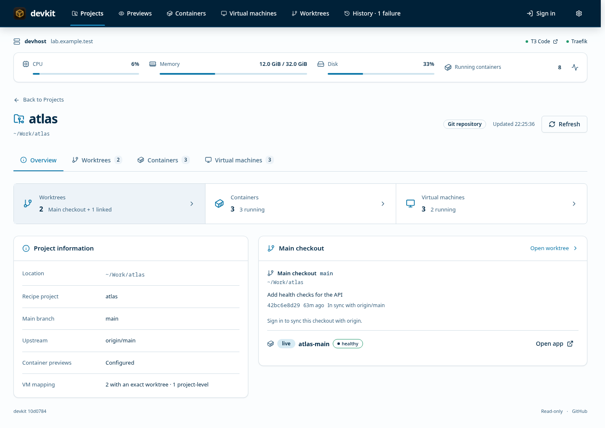
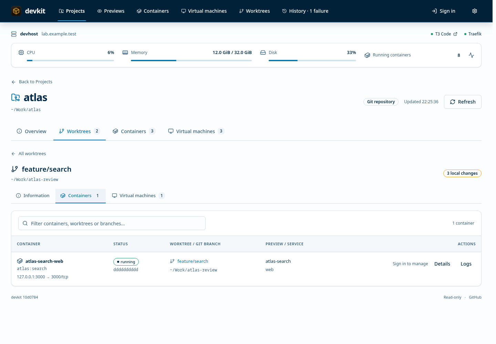

# Dashboard

https://devkit.<domain> is titled with the host's name (its hostname, or `name` in the host config)
and preview domain, and shows whether the harness (e.g. T3) and Traefik are up; the certificate
appears there only when it expires within three weeks. The header offers sign-in, and the gear menu holds sign-out and the theme;
the footer shows which devkit commit runs. Below is a CPU/memory/disk/containers summary bar (it
also mentions reclaimable Docker data from 5 GB up) that opens a system monitor: 10-minute history, swap,
per-container usage, top host processes and Docker disk use. Containers and processes
are sampled only while it is open.

The SwiftDesign navigation offers six views, remembered per browser. New links use `#/projects`,
`#/previews`, `#/containers`, `#/vms`, `#/worktrees` and `#/history`; existing links without
the slash continue to work. Projects, Previews, Containers, Virtual machines and Worktrees
show totals for their global inventories in the menu. Worktrees includes main and linked
checkouts; container and VM counts include stopped and unassigned resources. Counts refresh independently
of the selected project or local filters; a dash means the initial inventory has not loaded.
On narrow screens, use the navigation menu beside the logo:

- **Projects** (default for new browsers): a searchable directory of repositories and project
  folders, following SwiftConfig's host list/detail flow. Configure `projects_dir` in the host
  config to discover projects before anything runs. Open a project for **Overview**, **Documents**, **Worktrees**,
  **Containers** and **Virtual machines**. The top menu always remains global.
  Overview shows project information and the main checkout. Worktrees includes the main and
  linked checkouts; selecting one opens **Information**, **Containers** and **Virtual machines**
  scoped to that checkout. Project-wide runtime tables show worktree/branch links. Search is
  preserved when returning to the directory, including after a reload.
  Signed-in users can launch containers, control configured VMs, and fetch/sync/push each Git
  checkout. Sync only fast-forwards a clean branch tracking origin; Push stays a separate action.
  Folders needing recipes remain visible. Project, container and VM discovery fail independently;
  errors retain previous inventory with a visible warning. Paths and Git metadata are readable
  just like the global Worktrees view; recipe commands and VM disk paths are never returned.

<picture>
  <source media="(prefers-color-scheme: dark)" srcset="images/project-overview-dark.png">
  
</picture>

<picture>
  <source media="(prefers-color-scheme: dark)" srcset="images/project-worktree-dark.png">
  
</picture>

### Project resource ownership

Registered containers use their existing checkout mapping. Managed preview containers join to
an exact preview worktree and a unique service container ID. An unrelated Compose project with
a similar name is not added to the project. Resources with a known project but an unavailable
or conflicting checkout are labeled **Unassigned worktree** at project level.

The VM inventory supplies an opaque `worktree_key` when one discovered recipe claims the guest;
`/api/projects` checkout rows supply the corresponding key. UUID selectors take precedence over
names. Shared worktree claims stay project-level with an explanation, and conflicting project
claims stay in the global VM inventory. Stopped configured VMs follow the same rule. No raw VM
recipe/discovery paths or lifecycle commands are added to the public VM response. These keys
are presentation metadata, never action authorization. A VM without an exact worktree key is
not assigned to a branch by matching its name. If multiple repositories use the same recipe
project name and no exact checkout is known, the VM remains in the global inventory.

Project detail links encode the discovered project path as `#/projects/<encoded-path>/overview`.
Other sections are `worktrees`, `containers` and `vms`; a selected checkout uses the `tree` query
parameter and its local tab uses `resource`. Reload and browser back/forward retain this scope.
Missing projects or worktrees show a return link instead of selecting another target.

The remaining global views are:

- **Previews**: mode, health, branch/commit, uptime and URL. Below 768px, previews stack into compact entries with actions directly beneath their metadata, so no sideways scrolling is needed. Expanded service details stack with labels and wrap long paths and image names. Desktop keeps a bounded table with wrapping health summaries and metadata so Actions stay on screen. Click a preview name or its arrow to expand the same service information; use the external-open icon to visit the running app. Signed-in **Actions → Secrets** opens an overlay with that preview’s exact checkout secret context, including inherited values, without leaving the preview list. This overlay shows effective secrets with copy/reveal controls and Refresh only; scope selection, registration, adding and managing secrets remain on the normal project Secrets page; it is disabled if the checkout is missing or ambiguous. Opening the overlay never reveals secret values automatically; closing it clears revealed values and preserves the preview filters and expanded rows. A live preview shows its
  worktree's current commit and uncommitted changes, a review how far its worktree has
  moved on. Expand one for all its containers with ports (a routed port lists where it
  answers: paths such as `/api` as links, subdomain routes as `*.<preview>`), a details view (health,
  networks, mounts, environment with secret-looking values masked, labels) and logs
  (recent lines, or followed live). Previews whose worktree is gone (what `devkit gc`
  would remove) are marked, with a notice above the list.
- **Containers**: all running and stopped Docker containers on this host, including
  containers outside devkit. Filter by name, project, image, ID or status. Rows show
  state, image, project and configured host-to-container port mappings (mappings may
  be inactive while stopped). Managed preview containers retain Details/Logs links;
  registered existing stacks also offer Start, Details and Logs and appear in their owning project checkout. Registration preserves runtime and endpoints; see [existing Compose stacks](projects.md#existing-compose-stacks). Unregistered containers offer confirmed Turn off where safe and gain no detail/log access. `/api/containers` exposes only this inventory metadata,
  never raw labels, environment, mount paths or commands. Probes are bounded to five
  seconds, 512 containers and 2 MiB per batch. Errors retain the last result with a
  visible warning and Refresh button. The tab refreshes while visible.
- **Virtual machines**: active standalone QEMU and libvirt VMs grouped by project, with display/headless icons,
  allocated RAM/vCPUs, disk capacity, graphics and host CPU/resident-memory usage. Expand
  **Connect privately** for SSH tunnels and remote-viewer or guest SSH commands. See below.
- **Worktrees**: each repository's worktrees with their last commit, uncommitted
  changes, upstream distance and preview.
- **History**: what devkit did, newest first and grouped by day (see below). The tab
  counts failures of the last 24 hours, and an expanded preview lists its last few events.

Everything is read live from Docker labels, Git, QEMU processes and libvirt; there is no database.
The interface uses SwiftDesign components and SwiftConfig’s navigation, typography and table
layout. The settings menu offers all shared themes, including RN, RN Light, high-contrast
options and Match system. The initial theme is RN (dark); existing light/dark/auto choices
are migrated. Theme selection stays local to the browser.

Anyone on the tailnet can read it. To act from it, set a password on the host with
`devkit web password`; only a salted PBKDF2 hash is stored, in `~/.config/devkit/config.json`.
A browser that signs in can for 7 days start, stop, share, unshare and destroy previews,
start a live preview or review HEAD for a worktree, and clean up previews of removed
worktrees; changing the password signs every browser out. Each action runs the `devkit`
binary itself, as the CLI would, and the page shows its output live. The server only
accepts known host targets (or a new child of projects_dir for explicit project creation),
requests from the dashboard's own page, and an explicit confirmation for destroy and clean-up; five wrong passwords lock an address out for five
minutes. `exec` stays in the CLI.

With the T3 harness, a signed-in browser also gets **Pair device** beside the host services: it
shows a QR code, link and code from `devkit pair` that connect one phone or computer to T3 Code
within 10 minutes. devkit asks the `t3` version the T3 service runs (`t3 auth pairing create`),
returns the link to that page only, without keeping it, and records only that a pairing happened.

## Create Project

On the Projects directory page, **Create Project** opens a signed-in form for a name,
optional Git remote and additional agent instructions. The form shows the destination
under the configured `projects_dir` and the preserved devkit guidance. It copies the
complete starter template, initializes `main`, and makes one initial commit. An optional
remote only sets origin locally. Alternatively, **Create GitHub repository** accepts a
user/organization owner and repository name. Repositories start private; **Public
repository** is explicit. **Push initial commit** starts unchecked and uploads the
starter files and appended instructions only when selected. The host GitHub integration
must be configured first under **Secrets → Integrations**, service `github`, key `token`.
Follow [GitHub token setup](secrets.md#github-token-for-project-creation) for permissions,
safe storage and verification limits. Owner and push are selected for each project.
Existing destinations are refused; validation errors
keep your entries in the form. Successful jobs refresh the project catalog and global
counts. See [project creation](projects.md#create-a-project) for CLI usage and failure handling.

## Project documents

Open **Projects → a project → Documents** to read plans, specs and other Markdown
under `docs/`, including nested folders. Choose the main checkout or a linked worktree
from the checkout selector. The file list also exposes root `README.md`, `AGENTS.md` or `AGENT.md`
(case-insensitive names) as read-only documents. File and checkout choices are deep-linked
in the URL. The sidebar's **View** selector offers **Folder tree**, **Files only** (filenames without
folders or paths), and **Flat paths** (full relative paths). The choice is remembered in
this browser. Search works in every mode; hover a file to see its full path when names
repeat. Switching views keeps the selected document, draft and tree expansion state.
**Show** filters by **All documents**, **Milestones**, **Plans**, **Specs**, or **README**.
Milestones match path tokens such as milestone, milestones, m1 and m2; Plans match
plan/plans; Specs match spec/specs/specification/specifications. README matches the
filename README.md. Matching is case-insensitive and combines with search in all views.
A milestone under plans/ appears in both categories. Filtering keeps the open document
and draft intact.
Expand folder rows in the file tree, or use **Expand all** / **Collapse all** above it.
Search matches full paths and automatically expands matching folders; clear search to
restore your previous expansion state. Arrow keys navigate and expand/collapse the tree.
The selected document’s parent folders open automatically. Use **On this page** to
navigate longer plans.

The reader formats headings, lists, tables, quotes and code blocks. Relative Markdown
links open another supported document in the same checkout. Markdown images and HTML `<picture>`, `<source srcset>` and `` render local images
relative to the selected document and checkout. PNG, JPEG, GIF, WebP and SVG files up to
8 MiB are supported, including root logos; hidden paths, links and special files remain
blocked. SVG responses are sandboxed. Other raw HTML remains inert text. External HTTP(S)
images show **Load external image** and contact that host only after a click, without a
referrer; remote picture sources are omitted in favor of the image fallback. External
HTTP(S) links open separately. Other project source/assets are not served.

Fenced `mermaid` blocks render flowcharts (`flowchart` or `graph`, with a direction such
as `LR` or `TD`). Wide diagrams scroll horizontally; **Diagram source** reveals the code.
Invalid or unsupported diagrams keep their source and an explanation. Rendering is lazy,
limited to 20 diagrams per document, 20,000 characters and 250 edges per diagram.
Author Mermaid configuration, extended image/icon shapes and external resources are
not supported. Other Mermaid diagram types stay as readable source. The same media
rendering is used in the editor's Markdown preview.

Click any displayed picture or flowchart to open a large viewer. **+ / −** zoom in/out,
**Fit** fits the media to the window, and **100%** shows its natural size. Use the mouse wheel
directly to zoom around the pointer, without a modifier key.
On touch screens, pinch with two fingers to zoom around their midpoint. Drag with the
mouse or one finger to pan. These gestures affect only the media canvas, not page zoom.
Keyboard shortcuts are `+`, `-`, `0` (100%) and `F` (Fit). Escape or Close returns focus
to the item you opened. The viewer preserves the active picture source, resets when
the document changes, and releases temporary diagram images when closed.

**New document** and **Edit** require sign-in. Enter a path inside docs/ (for example
`plans/release.md`), write Markdown and use **Preview Markdown** before saving. New parent
folders are created as needed. Saves leave ordinary uncommitted changes in the selected
checkout; no Git commit or hook is run. Root README and agent guidance cannot be edited here.

A stale version, an existing new-file destination, or a failed save leaves the editor's
draft intact. If another tool changed a plan, copy your draft before reloading and reconcile
it with the new disk version. There is no force-overwrite button. Unsaved navigation asks
before discarding your draft; refresh/close uses the browser's unsaved-change prompt.
Drafts live in the current page, not persistent browser storage.

As with other dashboard reads, these files are visible to anyone who can reach the
private dashboard. Use docs/ for material suitable for that audience. Files must be
regular UTF-8 Markdown up to 256 KiB; hidden paths, symlinks, hardlinks and special files
are excluded. The listing stops at 1000 documents, 5000 scanned entries or 16 nested
levels and reports omissions. See [document CLI](projects.md#read-and-edit-documents).

## History

Every command that changes something records an event: project creation, setup, proxy up, a DNS record
setup created, live and review (created or resumed), start, stop, destroy (including `gc`), prune, publish, share, extend, unshare,
shares that expired and leftover tunnels or DNS records removed. QEMU cleanup records
successful stop, purge and registration removal separately so partial work remains visible. A failed command is
recorded too, with its error. Each event says who caused it: `cli` (also T3 actions),
`dashboard`, or `auto` for what the web service does by itself, such as expiring shares or the daily prune.
The log is one JSON line per event in `~/.local/state/devkit/history.jsonl`
(`$XDG_STATE_HOME/devkit` if set). At 1 MB it moves to `history.jsonl.1`, replacing the
older one, so about the last two megabytes are kept. Read it with `devkit history`
or on the dashboard; deleting it loses nothing but the past.

`devkit web` binds to 127.0.0.1 and `web.port` (3780). `devkit setup` installs it as the user
service `devkit-web`, and Traefik publishes it at `devkit.<domain>` on the tailnet. Repositories
appear from `projects_dir`, a preview, or a worktree matching the harness's `worktrees` glob.
The Projects tree also includes explicit `vm_projects` folders. See [project discovery](projects.md#discovering-projects-before-launch).

## Virtual machines

`devkit vms` lists the same inventory in a terminal; `devkit vms --json` returns the
read-only `/api/vms` response. Discovery needs no recipe, but project grouping uses
explicit `vms` name/UUID mappings in each project recipe (see [VM project mappings](projects.md#virtual-machines)).
Unmatched or ambiguous VMs appear under **Other VMs**, after the project groups.
Each VM includes a `project` slug (empty if unassigned) and, for conflicts, a
`project_note`; JSON remains a flat list. Filters match project names as well as VM
names. Group counts reflect the filtered rows.
The dashboard refreshes VMs while the Projects or VM tab is visible (every ten seconds, pausing
while a VM control has keyboard focus). It retains expanded connection sections.
A failed libvirt provider is a warning; other VM sources and Docker stay usable.

Discovery covers readable `qemu-system-*`/`qemu-kvm` processes and active domains
from `qemu:///session` and `qemu:///system` when `virsh` is installed. Session VMs
belong to the account running devkit. Guests with the same UUID deduplicate against
QEMU processes. Stopped guests with lifecycle settings remain listed; other stopped
libvirt definitions are not listed. Stopped standalone guests have no process to
inspect, so their allocation/display fields are unavailable until started. Standalone state means
host process state; it cannot tell whether the guest CPUs were paused via QMP.
Display type comes from configuration, not a check that a desktop has booted.

- A terminal icon means headless (`-display none`, `-nographic`, or no libvirt graphics).
  A monitor icon means a configured display. Unrecognized settings show **Display unknown**.
- RAM and vCPUs are configured allocations. Disk capacity is virtual capacity, excluding
  firmware and CD-ROMs, not host disk consumption. Simple local raw/qcow2 drives and
  libvirt block statistics are supported. Advanced standalone `-blockdev` graphs,
  network storage and unreadable disks may show **Unavailable**.
- CPU is sampled host usage: 100% means one core, and four busy vCPUs can reach 400%.
  The first sample is pending; the CLI's one-shot inventory has no CPU baseline.
  Resident memory is QEMU's host RSS, including overhead, not guest memory usage.
- Graphics lists configured virtual adapters. PCI passthrough is only called a GPU
  when host PCI class information confirms it. GPU utilization is not collected.

### Connecting from another device

Use the generated commands on your client computer, connected to the tailnet or
otherwise able to SSH to this host. They use the devkit user's account and configured
Tailscale IP (or detected tailnet IP, falling back to the hostname). Substitute your
SSH alias if you use a different destination/account. SSH authentication and host-key
verification remain your existing configuration; no private keys are read by devkit.

For SPICE on port 5931:

```sh
# Terminal 1 on your computer; keep this running:
ssh -N -o ExitOnForwardFailure=yes -L 127.0.0.1:5931:127.0.0.1:5931 mads@100.64.0.1
# Terminal 2 on your computer:
remote-viewer spice://127.0.0.1:5931
```

VNC uses `remote-viewer vnc://127.0.0.1:<port>`. Install the client with
`sudo dnf install virt-viewer` on Fedora or `sudo apt install virt-viewer` on Ubuntu.
If a local port is busy, change the first port in `-L` and the client command to the
same free port. End the tunnel with Ctrl+C. Display passwords are entered in the
viewer; devkit never reads or returns them.

Headless QEMU `-netdev user`, `-nic user`, and `-net user` TCP `hostfwd` entries to
guest port 22 get a private SSH tunnel and an SSH command that asks for the guest
username. Add your existing `-i` identity option if required. devkit does not infer
usernames, keys or bridged guest IPs. A headless libvirt guest also offers a serial
console through `ssh -t ... virsh --connect ... console <uuid>`; this requires a
configured guest serial console and libvirt permission. Ctrl+] leaves that console.

Only loopback or wildcard display/SSH listeners get automatic tunnel instructions.
Other addresses, Unix display sockets and TLS-enabled SPICE need the existing client
configuration. No display port is opened, no VM is modified, and VM connections
are not published through Cloudflare. Anyone who can read the dashboard can read
this sanitized inventory; connecting still requires SSH and guest authentication.

### VM lifecycle controls

VMs with [project lifecycle settings](projects.md#start-stop-and-restart-vms) show
Start when stopped, and Turn off/Restart when running, after you sign in. Plain VM
mappings do not authorize adapters; discovered native QMP/libvirt instances may separately offer stop-only Turn off. The page lists stopped managed guests too; register
VM-only projects through host `projects_dir` or `vm_projects` so their recipes remain discoverable.
Unavailable providers or conflicting definitions show an explanation instead of
action buttons. Paused adapter-managed guests offer Turn off; resume with their existing manager
before restarting.

Buttons run the same CLI commands through the dashboard's authenticated job
system. The job window shows progress/errors, then refreshes VM state. A failed
stop prevents restart. There is no dashboard VM destroy action or public display tunnel.
The CLI [QEMU cleanup command](projects.md#clean-up-standalone-qemu-vms) can stop and
unregister guests by name or project, retaining files unless an explicit purge adapter
is requested. Removed registrations disappear on the next inventory refresh.
The API adds `control_id`, supported `actions`, and optional `control_note` to
managed rows, without exposing recipe paths or launcher command text.


Turn off is available to signed-in users for individual active containers and VMs
with an existing adapter or verified native shutdown capability. Each action confirms
the resource and uses the CLI job flow; VM/project and container inventory refresh
when the job finishes. Anonymous users see a sign-in hint. Unsupported/paused resources
show their reason. This does not grant container log/detail access outside managed
previews or introduce deletion/force-off controls. See [projects](projects.md#turn-off-an-individual-vm-or-container).
VNC and SPICE can both appear under Connect privately, each with its own tunnel and
remote-viewer URI; the VM must actually expose the selected protocol.

## Building the dashboard

The Vue frontend compiles into `web/dist/`, which is embedded in the Go binary. Released
hosts need no Node runtime, CDN, or SwiftDesign checkout. To change the dashboard, see
[frontend development and checks](testing.md#frontend-development-and-checks). Go-only
builds use the committed production assets; frontend edits must regenerate them before
building the binary.

## Secrets

Choose Single value or Login when creating an entry. A login stores its username and password together, with separate reveal/copy controls and optional environment-variable mappings. The tab counts each login once; metadata does not expose either field.

Project tabs show counts for Documents (files in the selected checkout) and Secrets (active saved entries across all project scopes). Worktree Secrets badges count entries owned by that worktree. Secret counts require sign-in; unavailable counts show a dash. The Secrets panel provides separate scope and worktree/branch dropdowns (including a single checkout), explains project → branch → worktree inheritance, and identifies the selected branch and checkout path. Worktree-owned secrets stay local to that checkout; they do not appear in the parent branch even when both are labelled `main`. Per-secret History opens a dismissible modal with version timestamps/status and no values. The panel reveals values within their own rows, and provides copy icons without displaying values.

Project/worktree **Secrets** panels and **Settings → Secrets** require sign-in for
metadata and values. Reveal/copy requests are transient responses outside retained
action jobs; values clear on navigation/logout and after 30 seconds. Settings
include OpenBao status/native UI, manual update preview, encrypted backups,
integration credentials, agent skill repair and cleanup durations/`never`/automatic off.
All operations have [CLI equivalents](secrets.md). A sealed vault also prevents
authenticated dashboard access; use terminal unseal/recovery independently.
