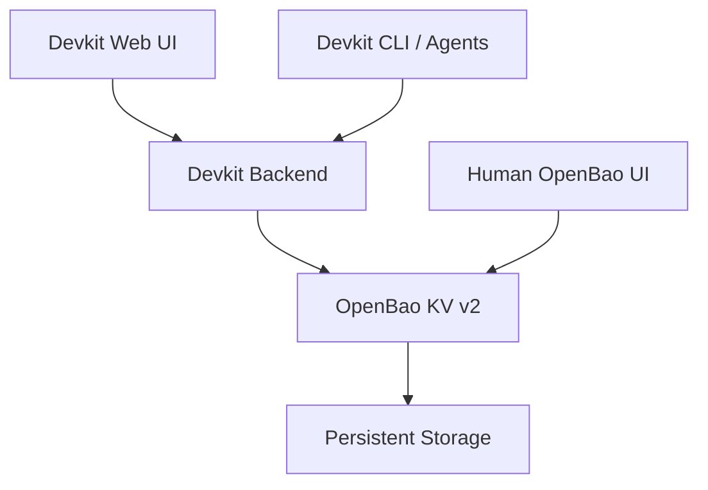

# Architecture and decisions

Devkit is a remote development manager running on one development server, with multiple managed projects and initially one human user. OpenBao is a **separate, Devkit-managed service** and the preferred/default secrets provider, but users may opt out to a clearly labeled local provider.



The Devkit backend owns project context, authorization, resource identity, settings references and cleanup jobs. CLI and UI call the **same authorization-enforcing backend**. OpenBao owns encrypted secret versions and credential policies. Never expose a privileged OpenBao token to project agents.

## Logical namespaces

```text
kv/devkit/system/<key>
kv/devkit/integrations/<integration-id>/<key>
kv/projects/<project-id>/shared/<key>
kv/projects/<project-id>/branches/<branch-id>/<key>
kv/projects/<project-id>/worktrees/<worktree-id>/<key>
```

IDs must be immutable and registered by Devkit; do not use filesystem paths or Git names alone. The actual KV v2 API uses `data/` and `metadata/` path conventions. Registry records track resource owner, scope, state, references and retention deadline.

## Non-goals for v1

- No production secrets or multi-server HA cluster.
- No mandatory MCP server (could be added later to call the same backend).
- No custom encryption algorithm or OpenBao replacement.
- No assumption that separate logical policies isolate untrusted agents sharing the same Unix identity or Docker socket.

## Important behavior

- Secrets for Devkit itself are isolated from project secrets.
- Vault-backed data fails closed when OpenBao is sealed or unavailable; no obsolete `.env` fallback.
- Human access to OpenBao's own native UI remains available separately from Devkit UI.
- A single-node deployment is not highly available: protect backups and recovery material.
